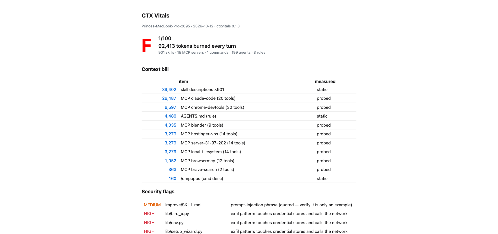

# ctxvitals

[](https://www.npmjs.com/package/ctxvitals)
[](LICENSE)

**A Lighthouse for your AI agent stack.** One command measures what every MCP
server, skill, command, and rules file actually costs you in tokens — before
your agent reads a single message.

```
npx ctxvitals
```

## The problem this answers

People running 15+ MCP servers can burn **60,000+ tokens per turn** on tool
schemas alone. Until now the only way to find out was grepping JSONL session
logs and guessing. ctxvitals launches each stdio MCP server itself, reads the
real `tools/list` response, and prints the actual bill:

```
CTX VITALS v0.1.0 · Princes-MacBook-Pro-2095 · 2026-10-12
══════════════════════════════════════════════════════════
GRADE: F (1/100)

CONTEXT BILL — tokens burned before the first message
   39,402 tok  skill descriptions ×901                static
   26,487 tok  MCP claude-code (20 tools)             probed
    6,597 tok  MCP chrome-devtools (30 tools)         probed
    4,480 tok  AGENTS.md (rule)                       static
    4,035 tok  MCP blender (9 tools)                  probed
    3,279 tok  MCP hostinger-vps (14 tools)           probed
    3,279 tok  MCP server-31-97-202 (14 tools)        probed
    3,279 tok  MCP local-filesystem (14 tools)        probed
    1,052 tok  MCP browsermcp (12 tools)              probed
      363 tok  MCP brave-search (2 tools)             probed
  ──────────────────────────────────────────────────
   92,413 tokens every turn

SECURITY
  HIGH    origin/SKILL.md        pipes remote content into a shell
  HIGH    composio-cli/SKILL.md  pipes remote content into a shell
  MEDIUM  mcp:claude-code        plaintext secret in config env (ANTHROPIC_API_KEY)
  MEDIUM  mcp:computer-use       command not found — stale config
  LOW     mcp:server-31-97-202   duplicate of mcp:hostinger-vps
  LOW     mcp:local-filesystem   duplicate of mcp:hostinger-vps
```

Yes, that's a real report from a real machine. Same MCP server installed under
three names. A plaintext API key in a config file. 92K tokens gone before
prompt one.

The `--html` flag produces a shareable report card ([demo.html](demo.html)):



## What it checks

| Surface | How |
|---|---|
| **MCP token cost** | Spawns each stdio server and reads the real `tools/list` schema — actual bytes, not estimates |
| **Skills** | Counts always-loaded frontmatter tokens vs on-trigger body tokens |
| **Rules files** | CLAUDE.md / AGENTS.md / GEMINI.md / .cursorrules / .mdc — always in context |
| **Security** | curl-pipe-sh, prompt-injection phrases, hardcoded secrets, exfil patterns, unpinned packages, plaintext keys in MCP env, non-TLS remote servers |
| **Hygiene** | duplicate servers, stale configs pointing at dead binaries, servers that hang or crash |
| **Grade** | A–F scorecard you can share |

It scans `~/.claude`, `~/.cursor`, `~/.codeium/windsurf`, `~/.copilot`,
`~/.config/devin`, `~/.agents`, `~/.codex`, `~/.gemini`, plus project-level
`.claude`/`.cursor`/`.devin`/`.agents` dirs and `mcp.json` configs in the
current directory. Zero dependencies, Node 18+.

## Usage

```bash
npx ctxvitals              # full audit: discovery + live MCP probing
npx ctxvitals --no-probe   # static only, no servers launched
npx ctxvitals --json       # machine-readable output
npx ctxvitals --html report.html   # shareable HTML report card
npx ctxvitals --badge      # README badge markdown with your grade
```

Probing runs the exact `command`+`args` from your own MCP config — the same
thing your agent client does on every launch. Nothing else is executed.
`--no-probe` opts out.

## The badge

```
[](https://github.com/princejain756/ctxvitals)
```

Put it in your MCP server or skill-pack README so users see what your tool
costs before they install it. That's the point.

## Also installable as a skill

This repo ships `skills/ctxvitals/SKILL.md`, so Claude Code / Devin / any
SKILL.md-compatible agent can run the audit itself:

```
git clone https://github.com/princejain756/ctxvitals
cp -r ctxvitals/skills/ctxvitals ~/.claude/skills/
# then ask your agent: "audit my agent stack"
```

## Grading

`A ≥ 90 · B ≥ 80 · C ≥ 70 · D ≥ 55 · F < 55`

Deductions come from measured numbers, not vibes: context bill size, server
count past 10, security flags by severity, unpinned packages, broken configs.
The scoring is in `bin/ctxvitals.js` — read it, argue with it, PR it.

## Roadmap

- [ ] Public leaderboard — measured token cost + flags for popular MCP servers and skills
- [ ] `--watch` mode: warn when a stack change inflates the bill
- [ ] CI mode with a `--max-tokens` / `--min-grade` gate
- [ ] Per-client compat matrix (what breaks where)

## Why a tool and not another list

Awesome lists tell you what exists. Registries tell you what's published.
Neither tells you what it costs, whether it's safe, or whether it works on
your setup. This is the missing vitals layer.

MIT © Prince Jain
